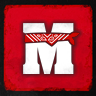

# Michigan Roleplay

### Abra sua empresa ou erga sua fazenda — e escreva sua história no velho oeste

 

&nbsp;

&nbsp;

 

**Roleplay sério, em português, num faroeste onde o sobrenatural existe.**

 

---

 

## O mundo

Michigan não é um servidor onde você só entra e atira. É um lugar onde a sua
história tem consequência — e onde o que você constrói continua de pé depois
que você desconecta.

 

<table>
<tr>
<td width="50%" valign="top">

### 🏛️ Empresas

**109 negócios** para comandar. Barbearia, botica, ferraria, hotel, jornal,
teatro, destilaria. Você abre, contrata, define o preço e responde pelo lucro.

</td>
<td width="50%" valign="top">

### 🐎 Fazenda e rancho

Monte seu rancho, crie seu gado, cuide da criação. Cavalos com pelagem,
idade e linhagem — cruza, treino e leilão fazem parte do jogo.

</td>
</tr>
<tr>
<td width="50%" valign="top">

### 🌕 Sobrenatural

**9 raças** e **77 poderes**. Vampiros, lobisomens e bruxas dividem a
fronteira com quem jura que nada disso existe — até a lua cheia provar
o contrário.

</td>
<td width="50%" valign="top">

### 🦌 Caça lendária

**41 animais lendários** espalhados pelo mapa. Rastrear, abater e vender
uma peça dessas é história que se conta na taverna por semanas.

</td>
</tr>
</table>

 

---

 

## Economia de verdade

O dinheiro tem origem e tem fim. Cada moeda entra no mundo por trabalho —
mineração, pesca, lenha, caça, colheita, contrato — e sai dele por imposto,
manutenção, salário e desperdício.

Não existe item que aparece do nada. Se está na sua mochila, alguém extraiu,
transportou ou fabricou.

 

---

 

## Os bastidores

Michigan é desenvolvido de forma aberta. Esta organização guarda o servidor inteiro.

 

| | |
|:--:|:--|
| **715** | repositórios nesta organização |
| **408** | recursos ativos no servidor |
| **117** | sistemas escritos do zero para o Michigan |
| **196** | mapas e construções |
| **4** | temporadas — o mundo já foi reescrito três vezes |

 

Construído sobre **ALX Framework** para RedM, com MariaDB, `ox_lib` e `ox_target`.
Cada sistema vive no seu próprio repositório, versionado por temporada.

 

---

 

## Entre para o servidor

O primeiro passo é o Discord. É lá que ficam as regras, o formulário de
whitelist e as pessoas que já moram nesse velho oeste.

 

 
 

Michigan Roleplay · servidor brasileiro de RedM · Red Dead Redemption 2

